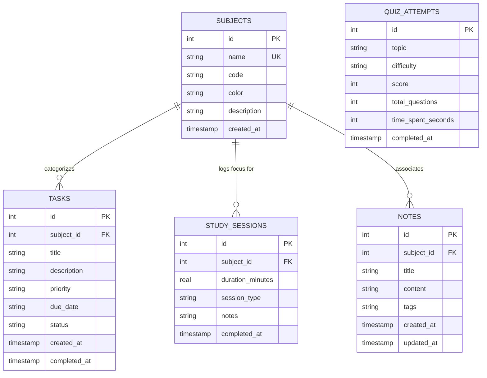

# 🪐 StudySphere — Your Personal Student Command Center

> A desktop academic productivity powerhouse engineered for computer science and data science university students. Built with **Python 3**, **CustomTkinter**, **SQLite 3**, **NumPy**, and **Matplotlib**.

[](https://www.python.org/)
[](https://customtkinter.tomschimansky.com/)
[](https://www.sqlite.org/)
[](https://numpy.org/)
[](https://aditi22builds.github.io/studysphere/)
[](LICENSE)

---

### 🌐 [Click Here to Launch Live Interactive Web Simulator](https://aditi22builds.github.io/studysphere/)
Experience StudySphere's dark-mode dashboard, Pomodoro timer, and technical quiz directly in your browser without any installation!

---

## 📌 Project Overview

**StudySphere** is an all-in-one desktop productivity application designed to bridge the gap between academic task management and empirical study analytics. Created as a signature portfolio project for a 2nd-year **B.Tech Computer Science & Engineering (Data Science)** student, StudySphere demonstrates mastery of:
- **Object-Oriented Programming (OOP)** and clean architectural separation of concerns (MVC pattern).
- **Relational Database Design** in SQLite with foreign keys, transactional integrity, and parameterized queries.
- **GUI Development** with CustomTkinter, achieving a dark-mode desktop interface.
- **Data Science Integration** via NumPy for descriptive statistics and trend regression, rendered directly into Tkinter using Matplotlib canvases.
- **Asynchronous / Non-Blocking Timers** using event loops for Pomodoro focus sessions.

---

## ✨ Core Features & Modules

### 1. 📊 Central Dashboard
- **Real-Time Database Statistics**: Cards displaying Total Tasks, Completed Rate (%), Today's Focus Hours, Active Courses, and Overdue Warnings.
- **Weekly Productivity Mini-Chart**: Visual bar chart of daily focus hours over the last 7 days.
- **Upcoming Deadlines Panel**: Prioritized chronological view of imminent assignments with countdown pills.
- **Recent Activity Feed**: Real-time study session history.
- **Rotating Tech Wisdom**: Daily motivational programming and data science quotes.

### 2. ✅ Advanced Task Manager (Full CRUD)
- **Comprehensive Task Creation**: Title, subject association, priority (Low, Medium, High), due date, and rich notes.
- **Quick Date Shortcuts**: Instant 1-click buttons for *Today*, *Tomorrow*, *+3 Days*, and *+7 Days*.
- **Multi-Criteria Filtering**: Filter by status (*All*, *Pending*, *In Progress*, *Completed*), priority (*High*, *Medium*, *Low*), and subject.
- **Real-Time Search**: Instant keyword search matching across task titles and descriptions.
- **Overdue Detection**: Highlights overdue assignments with red badges and day calculations.

### 3. 📚 Subject & Curriculum Manager
- **Course Administration**: Register course titles, course codes (e.g., `CS201`, `DS204`), descriptions, and hex color tags.
- **Aggregated Academic Metrics**: Each course card computes total tasks, pending tasks, completion percentage progress bar, and cumulative logged study hours.
- **Referential Integrity**: Deleting a subject safely reassigns linked tasks to General/Unassigned using SQLite `ON DELETE SET NULL`.

### 4. ⏱️ Focus Timer (Pomodoro Engine)
- **Standard Pomodoro Intervals**: 25-minute Focus, 5-minute Short Break, 15-minute Long Break, and 45-minute Custom Deep Work.
- **Non-Blocking GUI Event Loop**: Powered by Tkinter's `after()` scheduler, preventing interface freezing.
- **Course Association**: Link deep-work sessions directly to an academic subject.
- **Audio-Visual Feedback**: Visual completion status, progress bar, and system chime alerts upon session conclusion.
- **Automatic Persistence**: Completed sessions are logged directly to the SQLite `study_sessions` table.

### 5. 📈 Data Science Analytics Engine
- **NumPy Statistical Calculations**:
  - `np.mean()` & `np.median()`: Session duration central tendencies.
  - `np.std()`: Study variability and consistency score calculation.
  - `np.polyfit()`: Linear regression slope modeling study momentum (Rising, Steady, Declining).
- **Embedded Dark-Themed Matplotlib Charts**:
  - **Daily Focus Hours Bar Chart**: Last 7 days with dynamic maximum-hour highlights.
  - **Subject Distribution Donut Chart**: Visual proportion of study time invested across enrolled courses.
- **Historical Session Table**: Full breakdown of study logs.

### 6. 💡 Technical Quiz Arena
- **Curated Question Bank**: High-quality computer science questions covering:
  - Python Core Syntax & Falsy Evaluations
  - Data Structures & Dictionary Hash Table Complexities
  - Object-Oriented Programming (Dunder Methods, MRO, `@property`, `@classmethod`)
  - NumPy ndarrays, Vectorization, and Broadcasting Rules
  - Exception Handling & the Global Interpreter Lock (GIL)
- **Configurable Rounds**: Select by difficulty (*Beginner*, *Intermediate*, *Advanced*, *All*) and question count.
- **Live Round Timer**: Countdown tracking elapsed time.
- **Comprehensive Results & Explanations**: Percentage score, time spent, and detailed educational explanations for every option.
- **Persistent Attempt History**: Saves quiz scores in SQLite for progress tracking.

### 7. 📝 Academic Notes Workspace
- **Split-View Architecture**: Note browser with keyword search and course filters on the left; markdown/code editor on the right.
- **Persistent Storage**: Title, course association, tags, multi-line content, and last-updated timestamps.

### 8. 🔔 Proactive Notifications & Alert Center
- **Categorized Alert Engine**:
  - 🔴 **CRITICAL**: Overdue assignments past their due date.
  - 🟡 **WARNING**: Assignments due today or within the next 48 hours.
  - 🔵 **INFO**: Daily study goal progress (e.g., target 120 mins).
- **Direct Inline Actions**: "Mark Done" shortcut directly on alert cards.
- **Live Badges**: Dynamic badge counters in the Topbar bell and Sidebar.

---

## 🏗️ Architecture & Project Structure

```
studysphere/
│
├── main.py                     # Application entry point & AppController
├── requirements.txt             # Python dependencies
├── README.md                    # Project documentation
├── .gitignore                   # Version control exclusion rules
│
├── database/                    # Persistence Layer
│   ├── __init__.py
│   ├── schema.sql               # Relational DDL definitions & indexes
│   ├── db_manager.py            # SQLite connection context manager & query helpers
│   └── studysphere.db          # Auto-generated SQLite database file
│
├── modules/                     # Business Logic & Domain Controllers
│   ├── __init__.py
│   ├── task_manager.py          # Task CRUD, regex validation & filters
│   ├── subject_manager.py       # Subject CRUD & course-level metrics
│   ├── focus_timer.py           # Pomodoro state machine & session recorder
│   ├── analytics.py             # NumPy statistics & Matplotlib dark figures
│   ├── quiz.py                  # Question bank & scoring engine
│   ├── notes.py                 # Notes CRUD & search indexer
│   └── notifications.py         # Deadline evaluation & alert thresholds
│
├── ui/                          # Presentation Layer (CustomTkinter)
│   ├── __init__.py
│   ├── theme.py                 # Design tokens (colors, typography, radii)
│   ├── sidebar.py               # Vertical navigation bar with badge counters
│   ├── topbar.py                # Header with date, quote & quick actions
│   ├── dashboard.py             # SaaS command center view
│   ├── tasks_view.py            # Task manager view & modal dialog
│   ├── subjects_view.py         # Course cards view & modal dialog
│   ├── timer_view.py            # Pomodoro countdown interface
│   ├── analytics_view.py        # Embedded data science charts
│   ├── quiz_view.py             # Interactive assessment screen
│   ├── notes_view.py            # Split-view note workspace
│   └── notifications_view.py    # Notification center view
│
└── tests/                       # Automated Test Suite
    ├── __init__.py
    ├── test_database.py         # SQLite schema & transaction tests
    └── test_modules.py          # Business logic & NumPy statistical tests
```

---

## 🗄️ Database Schema & Relational Design

StudySphere uses a normalized SQLite 3 database schema with Foreign Key enforcement (`PRAGMA foreign_keys = ON;`).



---

## 🚀 Installation & Running

### Prerequisites
- **Python 3.10+** (Tested on Python 3.13)
- Windows, macOS, or Linux

### 1. Clone the Repository
```bash
git clone https://github.com/your-username/studysphere.git
cd studysphere
```

### 2. Set Up a Virtual Environment (Recommended)
```bash
# Windows
python -m venv venv
venv\Scripts\activate

# macOS / Linux
python3 -m venv venv
source venv/bin/activate
```

### 3. Install Dependencies
```bash
pip install -r requirements.txt
```

### 4. Run the Application
```bash
python main.py
```

### 5. Instant Demo Seeding
When running the application for the first time, click **"⚡ Load Demo Data"** in the sidebar. This will instantly populate realistic Computer Science and Data Science coursework records (courses, LeetCode tasks, NumPy lab assignments, study sessions, notes, and quiz history) so you can immediately explore all charts, tables, and alert badges.

---

## 🧪 Running the Automated Test Suite

StudySphere comes equipped with comprehensive unit tests covering the database layer, CRUD operations, regex validators, and NumPy statistical calculations:

```bash
# Run all automated tests
python -m unittest discover tests

# Or run individual test modules
python -m unittest tests/test_database.py
python -m unittest tests/test_modules.py
```

---

## 💡 Key Computer Science & Data Science Concepts Demonstrated

| Concept | Implementation in StudySphere |
| :--- | :--- |
| **Encapsulation & OOP** | Domain models (`TaskManager`, `SubjectManager`, `FocusTimer`) isolate business logic completely from presentation widgets. |
| **Resource Management** | Python `@contextmanager` handles SQLite connections, guaranteeing deterministic closing and transaction rollbacks on errors. |
| **SQL Injection Prevention** | 100% of SQL statements use parameterized queries (`?` place-holders) rather than f-string string concatenation. |
| **Vectorized Statistics** | `AnalyticsEngine` uses `np.mean()`, `np.std()`, and `np.polyfit()` to compute central tendencies, variability, and regression slopes. |
| **Non-Blocking GUI Event Loop** | CustomTkinter runs smoothly at 60 FPS while the Pomodoro timer counts down using `root.after()` callbacks without freezing. |
| **Input Sanitization & Regex** | Date fields are validated with `^\d{4}-\d{2}-\d{2}$` and calendar validation to reject invalid leap days or malformed inputs. |

---

## 📦 Suggested Git Commit History

For a professional GitHub portfolio presence, consider committing with the following clean progression:

1. `feat: initial project setup, dependencies, and gitignore`
2. `feat(db): implement sqlite relational schema and database manager`
3. `feat(modules): implement task manager, subject manager, and regex validation`
4. `feat(timer): implement non-blocking pomodoro focus timer state machine`
5. `feat(analytics): integrate numpy statistical calculations and matplotlib charts`
6. `feat(quiz): build python technical question bank and scoring engine`
7. `feat(notes): implement split-view notes manager with search and subject filters`
8. `feat(notifications): add proactive deadline alerts and overdue reminders`
9. `feat(ui): assemble custom-tkinter master window, sidebar, and dashboard`
10. `test: add unit test suite for database and domain modules`
11. `docs: add comprehensive portfolio readme and architectural diagram`

---

## 🔮 Future Enhancements
- [ ] Export study analytics and session logs to PDF or CSV.
- [ ] Customizable sound notifications for Pomodoro intervals.
- [ ] Cloud sync / backup support.
- [ ] Expanded Quiz question banks for Data Structures and Machine Learning.

---

## 📄 License
This project is open-source and available under the [MIT License](LICENSE).
